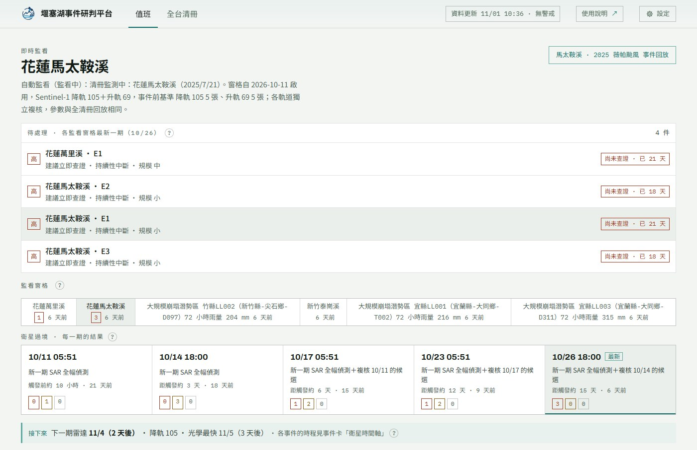

<p>
  <picture>
    <source media="(prefers-color-scheme: dark)" srcset="code/dashboard/img/logo-dark.svg">
    
  </picture>
</p>

# 堰塞湖事件研判平台

**網站：<https://barrier-lake-overflow.github.io/barrier-lake-overflow/>**

開源空間資訊於國家韌性應用黑客松競賽（OSSInt 2026）· 災害防救賽道 · 由 **程式這樣寫對不隊** 開發



## 這個系統在做什麼

颱風、豪雨或地震後，山區可能有崩塌堵住河道、形成堰塞湖，但這時常常雲多、路斷，光學影像和人員都很難馬上到位。

本系統用 **Sentinel-1 衛星雷達**（能穿雲、日夜都能拍）每一次經過時的影像，找出「事件前沒有、事件後才出現的疑似水體」，
整理成一件件**疑似事件**，附上證據、還缺什麼證據，排出**要多快處理**，並建議下一步任務（例如派 UAV、調閱光學影像、等下一期複核）。
最後由值班人員查證、決定。

三條原則：

- **雷達只提供證據，不直接下結論。** 雷達在崩塌堆積或陡坡陰影上也會看到像水的訊號，要經過下一期複核與人工查證。
- **系統整理與排序，人員做最後判斷。** 只有雷達證據時，研判信心最高到「中」。
- **串接既有成果，不重做。** 他單位已發布的光學判釋、航拍，會依時間與位置自動對到事件，當作獨立證據。

## 給誰用

| 使用者 | 用來做什麼 |
|---|---|
| **值班人員**（主要對象） | 一打開就看各監看地點有沒有要處理的事件、該先查哪一件、派誰去做什麼，查證後記錄結果 |
| 主管、查詢歷史資料的人 | 「全台清冊」分頁：全台歷年堰塞湖、3D 地圖、風險背景 |
| 系統維護者 | 網址加 `?admin` 的「系統管理」分頁：每日自動更新的狀態、執行紀錄與錯誤原因 |

## 怎麼開、怎麼用

| 想做什麼 | 怎麼開 |
|---|---|
| 看現在的狀況（值班） | 打開網站，預設就是「值班 · 即時監看」 |
| 看一次完整的歷史事件（報告、教學） | 網站按右上角「2025 馬太鞍溪事件回放」，或直接開 [`#drill`](https://barrier-lake-overflow.github.io/barrier-lake-overflow/code/dashboard/#drill) |
| 不知道怎麼操作 | 網站右上角「使用說明」：一上班先看什麼、畫面上什麼在哪裡、事件怎麼處理，都有圖 |
| 想換淺色／深色、字太小、想看資料來源 | 網站右上角「⚙ 設定」：外觀（預設跟隨電腦的深淺色）、字體大小（標準／大／特大）與提供資料的單位 |
| 在自己電腦上看 | 直接開 `code/dashboard/index.html`，不用安裝任何東西，離線也可以 |
| 改程式、重跑分析 | 見 [`docs/reproduce.md`](docs/reproduce.md)（需要 Python 3.11 以上） |

值班的基本流程：看頂端資料更新時間 → 看「待處理」清單 → 點最上面一件 → 依事件卡的建議任務處理 → 記錄人工查證。

事件卡的**衛星時間軸**列出這個事件出現以後已經拍到的雷達、光學影像（光學可直接「開啟影像」到 Copernicus Browser），以及下一期複核前還會有哪些衛星經過，值班人員不用乾等下一期雷達。

資料每兩天由 GitHub Actions 自動更新一次（清冊、警戒、雨量、衛星影像、新聞），設定見 [`docs/daily.md`](docs/daily.md)。

## 驗證結果（重點）

| 案例 | 結果 |
|---|---|
| 2025 馬太鞍溪（正案例） | 形成後第 7 天偵測到、第 13 天複核確認；3 個誤報從頭到尾沒進高優先 |
| 2026 同地點汛期（負案例） | 整季 1 個誤報（崩塌堆積），研判信心從未到「高」；Sentinel-2 與福衛八號查證都不是水，福衛八號同日雷達比對顯示那裡本來就暗 |
| 清冊 23 筆全部回放 | 偵測到 7 筆（隨機猜只會中 3.1 筆）；大型湖（≥ 20 萬 m³）7 筆中 5 筆 |
| 草嶺漏報 | 湖只存在約兩天，期間沒有任何衛星經過 |

完整數字、分析與已知限制見 [`docs/validation.md`](docs/validation.md)。

## 資料夾

```
code/
  dashboard/     網站（純靜態，index.html 直接開；help.html 是使用說明）
    data/        網站讀的資料（程式產生，不要手動改）
  pipeline/      核心流程：讀資料 → 雷達前處理 → 偵測 → 事件研判；daily/ 是每日自動更新
  scripts/       獨立腳本：GEE 匯出、跑偵測、診斷、實驗（用途見 code/scripts/README.md）
  tests/         自動測試（cd code && pytest）
data/
  raw/           原始資料：清冊、情境設定、衛星影像（小檔進版控）
  derived/       每一期的偵測結果 final_*.json；satpasses/ 是演練回放的衛星過境紀錄
  live/          每日自動更新的狀態、監看窗格、執行紀錄
docs/            所有說明文件（目錄見 docs/README.md）
  evidence/      證據圖：雷達偵測、航照、負案例查證
  results/       分析程式算出的數字（敏感度、調參等）
```

**驗證結果放在哪裡：**

| 想看 | 位置 |
|---|---|
| 所有驗證結果的說明與數字 | [`docs/validation.md`](docs/validation.md) |
| 證據圖（雷達、航照、光學查證） | [`docs/evidence/`](docs/evidence/) |
| 每一期偵測的原始結果 | [`data/derived/`](data/derived/)（`final_*.json`） |
| 參數依據、敏感度、測試過沒採用的方法 | [`docs/parameters.md`](docs/parameters.md)、[`docs/results/`](docs/results/) |
| 雷達湖面與航照比對 | [`docs/aerial-validation.md`](docs/aerial-validation.md) |
| 福衛八號查證、D8 河網與官方水系比對 | [`docs/fs8-validation.md`](docs/fs8-validation.md) |
| 草嶺為什麼漏報 | [`docs/bl070-diagnosis.md`](docs/bl070-diagnosis.md) |

## 資料來源

感謝以下單位提供資料（網站右上角「⚙ 設定」也有同樣的清單；各項用途與授權見網站使用說明「資料來源與授權」）：

| 單位 | 資料 | 用途 |
|---|---|---|
| 農業部農村發展及水土保持署 | 堰塞湖清冊（<https://tech.ardswc.gov.tw/Results/BarrierLakeInfo>），75 筆，1979–2026 年 | 全台清冊、對照壩址、監看窗格 |
| 歐盟 Copernicus 計畫（ESA） | Sentinel-1 雷達、Sentinel-2 光學。*Contains modified Copernicus Sentinel data (2015–2026)* | 事件偵測、小地圖底圖、光學判讀、衛星時間軸 |
| 美國地質調查局（USGS） | Landsat 8/9。*Landsat imagery courtesy of the U.S. Geological Survey* | 底圖補洞、光學判讀、衛星時間軸 |
| 日本宇宙航空研究開發機構（JAXA） | GSMaP 衛星雨量 | 風險模型、過境前雨量 |
| 美國國家航空暨太空總署（NASA） | NASADEM 地形 | 河網、湖底高程 |
| 農業部林業及自然保育署航測及遙測分署 | 馬太鞍溪航照（2025 年 7 個日期） | 湖面範圍驗證、小地圖航照圖層；原始檔不進版控 |
| 國家太空中心 | 福衛八號（© 國家太空中心） | 候選查證、小地圖水面與裸露堆積範圍；授權規定原始影像不得上網，只公開不含影像的衍生範圍與數值 |
| 內政部國土測繪中心 | 通用電子地圖水系、村里界 | 河網比對、保全對象 |
| Google Earth Engine | 影像查詢與計算平台 | Sentinel、Landsat、GSMaP、NASADEM 都在這裡查詢與計算 |

其他早期整理的開放資料清單見 `docs/reference/ossint-open-data-atlas.html`。

## 更多文件

整套系統的規格見 [`docs/system-spec.md`](docs/system-spec.md)；其他文件依主題列在 [`docs/README.md`](docs/README.md)。
